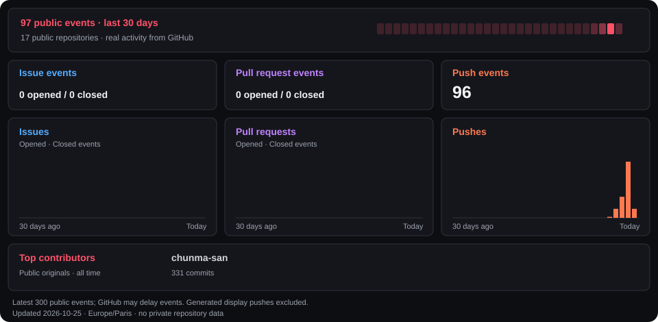

<!-- typing-title:start -->

  

<!-- typing-title:end -->

  

<h1 align="center">chunma</h1>

<b>My tools. My own path.</b> Self-hosted tools · Discord bots · Automation

    

<!-- discord-presence:start -->

  

<!-- discord-presence:end -->

<!-- PUBLIC-PROJECTS:START -->
## Public activity & projects

**13 public repositories**, synchronized automatically. New public projects appear here and in [Awesome Toolbox](https://github.com/chunma-san/awesome-toolbox).

| Project | What it does | Language |
| --- | --- | --- |
| [awesome-toolbox](https://github.com/chunma-san/awesome-toolbox) | A categorized collection of apps, self-hosted services, developer tools and gaming utilities, with a searchable web catalog. | HTML |
| [chunma-san](https://github.com/chunma-san/chunma-san) | Profile artwork, Discord presence and self-hosted projects. | — |
| [discord-archive](https://github.com/chunma-san/discord-archive) | A modular Discord event archive with audit logs, moderation records and voice dashboards. | Python |
| [discord-community](https://github.com/chunma-san/discord-community) | A configurable AION 2 Discord community bot with guild areas, events, roles and character profiles. | Python |
| [discord-companion](https://github.com/chunma-san/discord-companion) | An anime and manga Discord companion with chapter alerts, GrapheneOS news and a private link library. | C# |
| [discord-voice-keeper](https://github.com/chunma-san/discord-voice-keeper) | A silent Discord voice bot with a saved channel and automatic connection maintenance. | Python |
| [music-downloader](https://github.com/chunma-san/music-downloader) | A URL-based music download helper with optional owner-restricted Telegram controls. | Python |
| [music-metadata](https://github.com/chunma-san/music-metadata) | Music metadata matching and batch confidence reports for local audio collections. | Python |
| [steam-idle-monitor](https://github.com/chunma-san/steam-idle-monitor) | Idle and farming interval estimates from ArchiSteamFarm Docker logs. | Python |
| [teamspeak-control](https://github.com/chunma-san/teamspeak-control) | Discord controls for configured TeamSpeak audio-bot containers and an announcement timer. | Python |
| [teamspeak-timer](https://github.com/chunma-san/teamspeak-timer) | Configurable TeamSpeak announcements through TS3AudioBot APIs with local timer control. | Python |
| [telegram-music](https://github.com/chunma-san/telegram-music) | A configurable Telegram audio saver with persistent processing history and local session storage. | Python |
| [Wand-Enhancer](https://github.com/chunma-san/Wand-Enhancer) · Fork | chunma edition of Wand Enhancer: blue theme, automated upstream sync and reproducible Windows builds. | C# |

Activity charts use GitHub’s public event timeline (up to 300 events over 30 days). Event delivery can be delayed. Pushes to the generated profile and catalog are excluded to prevent display-update loops. Contributor totals cover public non-fork project repositories and are all-time, not a 30-day count.

<!-- PUBLIC-PROJECTS:END -->

## Featured projects

<table>
<tr>
<td width="50%" valign="top">
<h3>⚔️ Discord Community</h3>

AION 2 guild spaces, opt-in roles, event signups and character profiles.

<a href="https://github.com/chunma-san/discord-community">Explore project →</a>
</td>
<td width="50%" valign="top">
<h3>📚 Discord Companion</h3>

Anime searches, chapter alerts, GrapheneOS updates and a private link library.

<a href="https://github.com/chunma-san/discord-companion">Explore project →</a>
</td>
</tr>
<tr>
<td width="50%" valign="top">
<h3>🪄 Wand Enhancer</h3>

An unofficial fork with a custom desktop theme, upstream synchronization and Windows builds.

<a href="https://github.com/chunma-san/Wand-Enhancer">Source →</a> · <a href="https://github.com/chunma-san/Wand-Enhancer/releases/latest">Latest release →</a>
</td>
<td width="50%" valign="top">
<h3>🎮 Steam Idle Monitor</h3>

Idle and card-farming interval estimates from ArchiSteamFarm logs.

<a href="https://github.com/chunma-san/steam-idle-monitor">Explore project →</a>
</td>
</tr>
</table>

## The toolbox

| Area | Projects |
| --- | --- |
| Discord | [Archive](https://github.com/chunma-san/discord-archive) · [Community](https://github.com/chunma-san/discord-community) · [Companion](https://github.com/chunma-san/discord-companion) · [Voice Keeper](https://github.com/chunma-san/discord-voice-keeper) |
| Music | [Downloader](https://github.com/chunma-san/music-downloader) · [Metadata](https://github.com/chunma-san/music-metadata) · [Telegram Music](https://github.com/chunma-san/telegram-music) |
| TeamSpeak | [Control](https://github.com/chunma-san/teamspeak-control) · [Timer](https://github.com/chunma-san/teamspeak-timer) |
| Desktop & automation | [Wand Enhancer fork](https://github.com/chunma-san/Wand-Enhancer) · [Steam Idle Monitor](https://github.com/chunma-san/steam-idle-monitor) |

## Next chapter

Planned improvements for this collection:

- [ ] More screenshots and short usage demos.
- [ ] Clearer setup and troubleshooting guides.
- [ ] More examples for configuring each tool.

---

  <a href="https://github.com/chunma-san?tab=repositories">All repositories</a> ·
  <a href="https://discord.com/users/891081797318897715">Discord profile</a>

<!-- CAT-COUNTER:START -->
## Profile visits

  

*Approximate README image loads since October 2026, not unique people. GitHub image caching and automated requests affect this count.*
<!-- CAT-COUNTER:END -->
